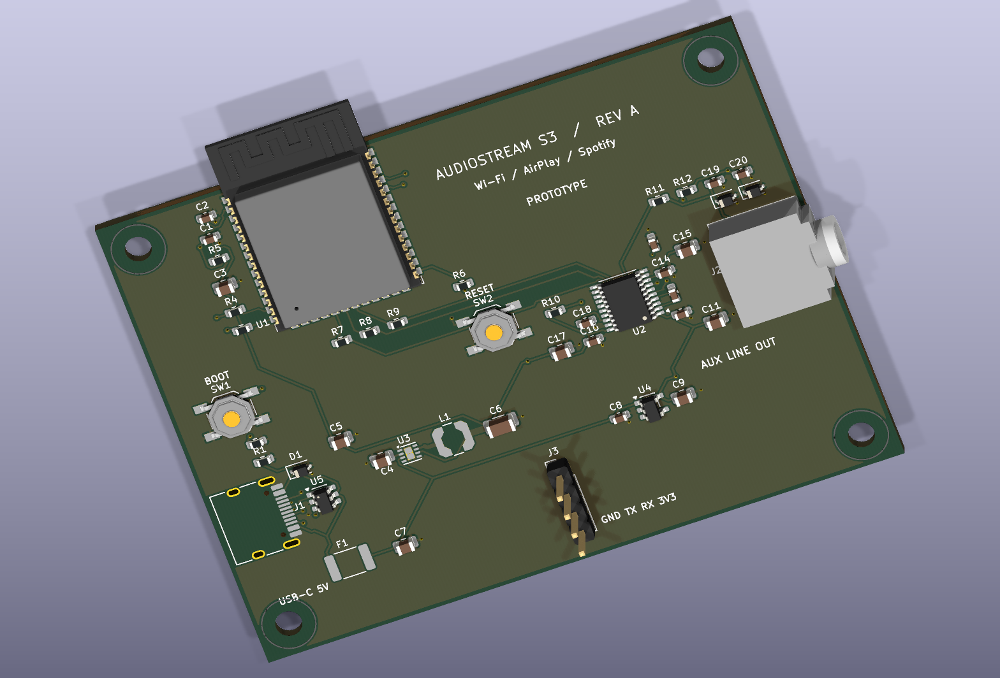

> 보관본(버전 기록 01). 다음 버전은 [LOVELACE / AS-001](../02-lovelace-as-001/README.md)(55×55mm)이고, 현재 보드는 [AS-003](../../lovelace-as-003/README.md)입니다. 전체 기록은 [archive/README.md](../README.md)에 있습니다.

# AudioStream S3 — Rev A 일체형 PCB

ESP32-S3-WROOM-1-N16R8 모듈과 PCM5102APWR DAC를 직접 실장하는 **80 × 60 mm, 4층 시제품 설계**입니다. 개발보드나 DAC 모듈은 필요하지 않습니다. Wi-Fi AirPlay / Spotify Connect → I2S → stereo AUX 출력을 목표로 합니다. S3에는 Bluetooth Classic/A2DP가 없습니다.

현재 상태는 **배선·ERC·DRC·제조 파일 연결 검사 완료, 실물 미검증**입니다. `fabrication-review/`는 검토용 제조 파일이며 생산 승인본이 아닙니다. 아래 제조 전 확인 항목을 해결한 뒤 발주하세요.



## 열 파일

- `audiostream-s3.kicad_pro`: KiCad 10 프로젝트. 회로·PCB·프로젝트 심벌·풋프린트를 함께 보관합니다.
- `audiostream-s3.kicad_sch`, `schematic.pdf`: 물리 핀 번호와 라벨로 연결한 회로도.
- `audiostream-s3.kicad_pcb`: 배선 및 구리면이 저장된 보드.
- `bom.csv`: 부품별 값·패키지·MPN 또는 요구 사양. 범용 수동 부품과 헤더는 구매 부품 선정이 남아 있습니다.
- `assembly.csv`: 보드 원점 기준 위쪽 실장 좌표, mm, KiCad 회전. 조립업체 제출 전 좌표계·회전을 확인해야 합니다.
- `fabrication-review/`: 4개 구리층, 마스크, 실크, 앞면 페이스트, 외곽, PTH/NPTH 드릴, IPC-D-356 넷리스트.
- `placement.json`, `reports/`: 배치 제약, 재확인 결과, 전원 계산, ERC/DRC, 거버 검사, 펌웨어 빌드 기록.
- `copper-layers.pdf`: 각 구리층을 개별 페이지로 확인할 수 있는 도면.

## 구성과 핀

| 기능 | 연결 |
|---|---|
| MCU | ESP32-S3-WROOM-1-N16R8, 16 MB Flash / 8 MB octal PSRAM |
| DAC | PCM5102APWR, TSSOP-20, BCK 기반 PLL |
| I2S BCLK | GPIO11 → R7 33Ω → DAC pin 13 |
| I2S DATA | GPIO12 → R8 33Ω → DAC pin 14 |
| I2S LRCLK | GPIO13 → R9 33Ω → DAC pin 15 |
| MCLK | 사용하지 않음; DAC SCK pin 12 = 실제 GND |
| DAC 모드 | FMT/FLT/DEMP = GND; XSMT는 10kΩ로 3.3V digital에 풀업 |
| USB | GPIO19 D−, GPIO20 D+, 22Ω 직렬 저항, USBLC6-2SC6 |
| USB-C | TYPE-C-31-M-12, CC1/CC2 각각 5.1kΩ Rd, 5V 입력 |
| Digital 전원 | TPS62162DSGR + 2.2µH LPS4018-222MRC → 3.3V |
| Analog 전원 | TLV75533PDBVR → 별도 3.3V |
| AUX | SJ1-3523N, Tip=L / Ring=R / Sleeve=GND |
| 출력 필터 | 채널별 470Ω + 2.2nF, 양방향 PESD5V0S1BA ESD 보호 |
| 복구 | BOOT=GPIO0, RESET=EN; UART 헤더 J3=GND/TX/RX/3V3 순서 |

AUX는 앰프 내장 스피커의 line input용입니다. DAC 출력은 약 2.1 Vrms full-scale이며, 헤드폰을 직접 구동하는 출력으로 설계하지 않았습니다. GPIO14를 접지로 사용하지 않습니다. N16R8의 내부 메모리 관련 GPIO35/36/37은 외부로 연결하지 않습니다.

## 층과 배치

L1=부품·신호·GND, L2=신호 배선이 없는 GND 면, L3=좌측 digital / 우측 analog 3.3V 영역, L4=신호·GND입니다. 기판 두께 1.6 mm, 외층 1 oz, 내층 0.5 oz는 계산용 가정이며 제조사 스택업 확정이 남아 있습니다.

| 영역 | 위치 (PCB x/y, mm, y 아래 방향) |
|---|---|
| MCU/RF | x15–35, y0–21; 안테나는 상단 밖으로 돌출 |
| USB/보호 | x0–16, y32–52 |
| Digital 전원 | x18–39, y35–42 |
| DAC/전하펌프 | x45–67, y24–37 |
| Analog 전원 | x49–61, y42–46 |
| AUX/출력 필터 | x63–83, y18–37; 잭이 우측으로 돌출 |

부품 점유율은 사용 가능 면적의 약 25%입니다. 배치 좌표 전부는 `design.json`과 `assembly.csv`에 있습니다. M3 홀 중심은 (4,4), (76,4), (4,56), (76,56)이며 3.5 mm 반경에 구리·배선·비아를 금지했습니다. 안테나 바깥쪽 약 15 mm에는 케이스 금속·나사·케이블을 두지 마세요. USB 몸체 밑은 L1 구리·비아 금지이며 핀열의 기판 안쪽에서 신호를 뽑았습니다.

## 전원 예산과 경로

설계 가정: MCU 3.3V 500 mA peak, DAC digital 10 mA, analog/charge-pump 50 mA. 90% buck 효율을 가정하면 5V 입력은 약 425 mA이고, 여유를 포함한 경로 검토 전류는 550 mA입니다. 이는 측정값이 아닙니다. USB-C 5V/1A 이상 전원으로 bring-up하세요.

| 경로 | 검토 전류 | 실제 최소 선폭 / 비아 | 제한 요소 |
|---|---:|---|---|
| VBUS → F1 → 5V → regulator 입력 | 0.55 A | 0.15 mm 이상, 5V net에 층간 비아 없음 | MF-MSMF075-2 hold 0.75A; 온도 derating 및 입력 과도전류 확인 필요 |
| Buck → digital 3.3V → MCU/DAC DVDD | 0.51 A | 국부 0.15 mm, L1 인덕터→C6 0.8 mm, 0.3 mm drill 전원 비아 | 가장 좁은 국부 배선·단일 공급 비아 및 실제 도금 두께 |
| Analog LDO → DAC AVDD/CPVDD | 0.05 A | 0.15 mm 이상, 0.3 mm drill 전원 비아 | 요구 전류 대비 여유 있는 LDO; 실제 레일 노이즈가 핵심 |

`pcbcalc.py` 결과: 외층 1 oz / 10°C 상승 / 0.5A의 권장 폭은 약 0.145 mm(25% 여유 포함)입니다. 일반 비아는 외경 0.6 / 홀 0.3 mm입니다. 계산에 사용한 25µm 도금의 단일 0.3 mm 비아 한도는 약 0.63A이며, 제조사가 실제 도금을 보장해야 합니다. USB 핀열만 외경 0.4 / 홀 0.2 mm 비아 2개를 사용합니다. WSON 열패드에도 0.2 mm 홀을 사용하므로 최소 드릴 0.2 mm 옵션이 필요합니다.

각 로컬 GND 커패시터와 ESD 다이오드에 전용 GND 비아를 추가했습니다. 안테나·홀·USB 몸체 금지 영역, 면 연결, 실제 구리 연결은 저장된 PCB와 거버에서 검사했습니다.

## 검증 결과

| 검사 | 결과 |
|---|---|
| 스킬 배치 검사 / 실제 PCB 재확인 | ERROR 0 / WARN 0 |
| KiCad ERC | 오류·경고 0 |
| KiCad DRC | 오류·경고 0 / 미연결 0 / footprint 오류 0 |
| 스크립트 배선 검사 | 부품 좌표 일치, 내부층 신호 0, 비정상 각도 0, USB 몸체 내 L1 배선 끝점 0 |
| 제조 파일 구성 검사 | 오류·경고 0, 4개 구리층 확인 |
| IPC-D-356 대 거버 구리 | 256/256 패드·비아 확인, shorts 0 / opens 0 / missing copper 0 / undrilled 0 |
| 거버 앞·뒤 렌더 | 마스크 개구부 위 실크 0 mm², 구리-외곽 최소 약 0.505 mm |
| PCB 프로필 펌웨어 | PlatformIO 빌드 성공 |

거버 연결 검사는 50 px/mm raster 검사이며 KiCad DRC와 함께 해석해야 합니다. 부품 실제 동작, USB 적합성, RF 성능, AUX 노이즈는 이 검사들로 증명되지 않습니다. ERC는 프로젝트에 내장된 물리 핀 심벌 기준입니다.

## 제조 전 확인할 항목

1. **USB pair**: 현재 D+/D−는 연결·간격 검사를 통과한 시제품 배선입니다. 최종 제조사 스택업으로 90Ω 차동 임피던스, 경로별 길이 차, 리턴 비아를 다시 설계·검토해야 합니다. USB_DM의 비아 수에는 중복 커넥터 핀 두 갈래가 포함됩니다. 일반 net 길이 합은 pair skew 측정값이 아닙니다.
2. **USB 입력 돌입전류**: 전원 입구에 10µF 커패시터 두 개가 있으며, 호스트 USB의 돌입전류·열거 전 전류 제한을 검증하지 않았습니다. USB 규격에 맞는 제품으로 만들려면 전류 제한/슬루율 제어 전원 스위치와 필요시 CC 전류 검출을 추가하세요. 현재는 PD 협상 없이 5V만 받습니다.
3. **부품 선정·조립**: 범용 수동 부품 MPN과 supplier ID, MLCC DC bias, 특히 C6의 3.3V에서 유효 출력 용량(권장 22µF 이상)을 확인해야 합니다. CPL 회전·커넥터 fit, 패널 tooling/fiducial, WSON 열패드의 paste/비아 처리와 bulk pad 비아 수를 조립업체와 확인하세요. 자동 PCBA 제출용 BOM/CPL 승인본이 아닙니다.
4. **부품/케이스 fit**: SJ1-3523N의 stock footprint Edge.Cuts 선은 F.Fab으로 옮겨 외곽을 닫았습니다. 실제 잭·USB 커넥터의 보드 가장자리 위치와 하우징 clearance를 확인해야 합니다. USB 커넥터에는 번들 3D 모델이 없어 3D 화면에서 풋프린트만 표시됩니다.
5. **실기기 측정**: 3.3V droop, 벅 SW node/리플, Wi-Fi 전송 중 AUX 노이즈, mute/power-off pop, 열을 측정하세요. 현재 XSMT는 풀업 상태이며 전원 소실을 선제 감지하는 mute 회로는 포함하지 않았습니다.

## 펌웨어와 bring-up

프로젝트 루트에서:

```sh
export PLATFORMIO_CORE_DIR="$PWD/work/platformio"
.venv/bin/pio run -d firmware -e audiostream-s3-pcb
.venv/bin/pio run -d firmware -e audiostream-s3-pcb -t upload
.venv/bin/pio run -d firmware -e audiostream-s3-pcb -t uploadfs
```

BOOT를 누른 채 RESET을 눌렀다 떼면 USB 다운로드 모드로 들어갑니다. USB Serial/JTAG를 통해 업로드할 수 있습니다. 기본 펌웨어 UART 로그는 J3의 TX/RX를 3.3V USB-UART 어댑터로 연결해서 확인하세요. J3 3V3는 보드 전원 레일이며 두 전원을 병렬로 연결하지 마세요. 이 프로필은 GPIO LED와 배터리 모니터를 끄고 PCM 캡처 기능은 유지합니다.

처음에는 전원 OFF 상태에서 각 레일과 GND 사이 단락을 측정합니다. 전류 제한 전원을 100mA부터 올리면서 digital/analog 3.3V를 먼저 확인하고, Wi-Fi 부팅에 필요한 전류를 허용한 뒤 Flash/PSRAM 용량과 부팅 로그를 확인하세요. AUX 스피커는 마지막에 연결합니다.

## 재생성

`plan_pcb.py` → 스킬 `placement_check.py`에서 ERROR/WARN 0 및 PNG 육안 확인 → `build_pcb.py` → FreeRouting DSN→SES → `finish_pcb.py` → `audit_pcb.py` → ERC/DRC 및 거버 검사 순서입니다. Python 보드 스크립트는 KiCad의 `pcbnew`가 제공되는 Python에서 실행하세요. 풋프린트는 이 폴더의 `lib/`를 사용합니다. 재생성은 최종 수동 편집을 덮어쓰므로 먼저 프로젝트를 복사하세요. 저장된 DSN/SES가 이번 배선의 재현 입력/출력입니다.

## 근거·출처

- [요청한 pcb-layout-design 스킬](https://github.com/studio-edul/pcb-layout-skill), 사용 revision `6284cc8c0fdbfda9452a63540a85510a3d2dbf37`.
- [ESP32-S3-WROOM-1 데이터시트](https://www.espressif.com/sites/default/files/documentation/esp32-s3-wroom-1_wroom-1u_datasheet_en.pdf) 및 [Espressif PCB 지침](https://docs.espressif.com/projects/esp-hardware-design-guidelines/en/latest/esp32s3/pcb-layout-design.html).
- [TI PCM5102A 데이터시트](https://www.ti.com/lit/ds/symlink/pcm5102a.pdf), [TPS62162](https://www.ti.com/lit/ds/symlink/tps62162.pdf), [TLV755P](https://www.ti.com/lit/ds/symlink/tlv755p.pdf).
- [Coilcraft LPS4018-222](https://www.coilcraft.com/en-us/products/power/shielded-inductors/ferrite-drum/lps/lps4018/lps4018-222/), [Nexperia PESD5V0S1BA](https://assets.nexperia.com/documents/data-sheet/PESD5V0S1BA.pdf).
- [JLCPCB 제조 capability](https://jlcpcb.com/capabilities/Capabilities). 실제 주문 옵션·stackup·최소 간격은 주문 전 재확인해야 합니다.
- 번들 풋프린트/3D 모델: KiCad 10.0.6 공식 배포본. 풋프린트 원본은 [KiCad footprints](https://gitlab.com/kicad/libraries/kicad-footprints), CC BY-SA 4.0 및 배포본의 사용 예외 적용. 3D 모델은 저장소에 복사하지 않았습니다.
