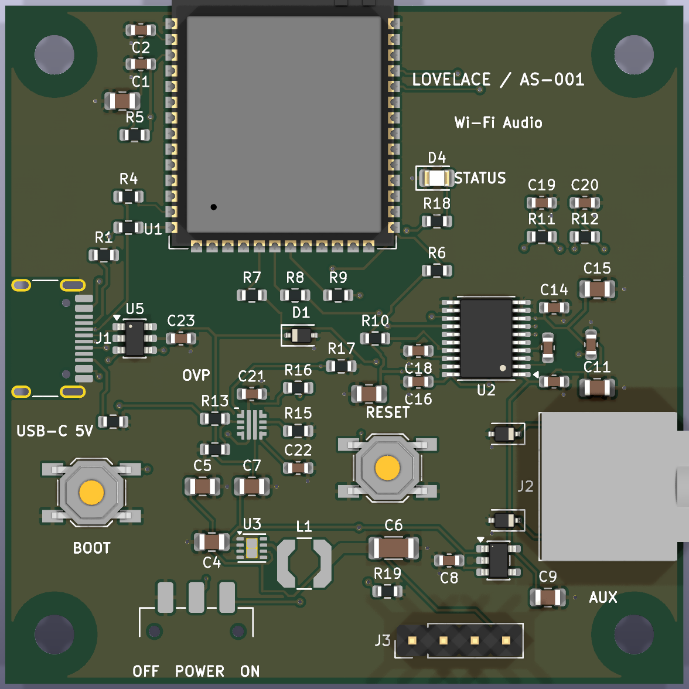

> 보관본(버전 기록 02). 다음 버전은 AS-002, 현재 보드는 [AS-003](../../lovelace-as-003/README.md)입니다. 전체 기록은 [archive/README.md](../README.md)에 있습니다.

# LOVELACE / AS-001

ESP32-S3-WROOM-1-N16R8와 PCM5102APWR를 직접 실장하는 **55 × 55 mm, 4층 시제품**입니다. 기존 80 × 60 mm보다 면적을 약 37% 줄였습니다. 이 치수는 PCB 외곽 기준이며 상단 안테나와 우측 AUX 잭은 외곽 밖으로 돌출합니다. 제품명은 LOVELACE, 하드웨어 버전은 AS-001입니다.

**검토용 설계이며 제조 승인본은 아닙니다.** ERC/DRC/거버 연결 검사와 펌웨어 빌드를 통과했지만 실물 전원·RF·음질·USB 검증은 아직 없습니다. 남은 문제는 [REVIEW.md](REVIEW.md)에 기록했습니다.



3D 이미지에서 USB-C, 전원 스위치, eFuse 등 일부 부품은 모델이 없어 패드만 보입니다. 실제 실장 여부는 BOM과 회로도를 기준으로 확인하세요.

## 사용과 표시

| 항목 | 현재 동작 |
|---|---|
| Wi-Fi | 음악 전달에 쓰는 네트워크입니다. 첫 설정에서 ESP32-AirPlay-Setup AP에 연결하여 192.168.4.1에서 집 Wi-Fi를 저장합니다. 이후 저장된 네트워크에 연결합니다. |
| AirPlay 2 | 휴대폰의 AirPlay 출력 목록에서 기기를 선택합니다. 같은 LAN에서 사용합니다. |
| Spotify Connect | Spotify 앱의 기기 선택 메뉴에서 선택합니다. 이 프로젝트는 Premium 계정 및 자체 Developer Client ID/Secret 설정이 필요합니다. `http://<기기 IP>/spotify`와 프로젝트 [SPOTIFY.md](../../../docs/SPOTIFY.md)를 참고하세요. |
| 음원 전환 | 별도 모드 버튼은 없습니다. AirPlay와 Spotify가 함께 대기하고 휴대폰에서 사용할 서비스를 선택합니다. 고정 우선순위 없이 마지막 재생/재개 요청이 출력을 가져옵니다. Spotify 선택 시 AirPlay 로컬 출력을 멈추지만 송신 앱의 원격 pause 상태까지 보장하지 않습니다. |
| Bluetooth | 일반 블루투스 스피커처럼 페어링해 음악 재생하는 A2DP 기능은 없습니다. ESP32-S3는 BLE를 지원하지만 Bluetooth Classic을 지원하지 않습니다. |
| BOOT | 실행 중 단독으로 누르는 동작은 지정되어 있지 않습니다. BOOT를 누른 채 RESET을 눌렀다 떼고 BOOT를 떼면 ROM 다운로드 모드로 진입합니다. Wi-Fi 초기화·음원 전환 버튼이 아닙니다. |
| RESET | 재생을 중단하고 MCU를 재부팅합니다. 저장된 Wi-Fi/설정을 지우는 공장 초기화 버튼은 아닙니다. |
| POWER | 슬라이드 스위치로 eFuse의 EN을 제어하여 MCU와 DAC의 전원을 끕니다. ON에서 다시 부팅합니다. USB 접지/CC와 eFuse 대기 전류는 남으므로 USB 전체를 물리적으로 분리하지는 않습니다. PC USB 연결 중 OFF 역급전은 실물 검증 대상입니다. |
| STATUS LED | GPIO21의 녹색 LED. 대기=100ms 켜짐/2500ms 꺼짐, 재생=계속 켜짐, 일시정지=500ms 켜짐/500ms 꺼짐. AirPlay와 Spotify 모두 반영합니다. Wi-Fi 연결 성공이나 음원 종류를 색상으로 표시하지 않습니다. |
| REV A / AS-001 | REV A는 첫 하드웨어 리비전이라는 뜻이었습니다. 이번 보드의 실크는 요청한 `LOVELACE / AS-001`로 변경했습니다. 이후 PCB 변경 버전은 AS-002 등으로 구분할 수 있습니다. |

## USB-C 충전기와 보호

15W/25W는 충전기가 공급할 수 있는 최대 **전력**이며 전압이 아닙니다. 정상적인 USB-C/PD 충전기는 고전압 계약 없이 기본 5V를 공급합니다. 이 보드는 CC1/CC2에 5.1kΩ Rd가 있고 PD 고전압 요청 기능이 없어서 9V/12V/20V를 요청하지 않습니다. 25W 충전기가 이 보드에 25W를 강제로 밀어 넣지는 않습니다. 보드가 필요한 전류를 가져갑니다.

잘못된 전원·트리거 케이블 등으로 높은 전압이 실제 들어오는 경우를 고려해 **TPS259470ARPWR 과전압 차단 eFuse**를 추가했습니다. R13=348k/R14=100k, 0.1% 저항으로 차단 기준은 명목 **5.376V**, 데이터시트 기준 오차 범위 약 **5.292–5.488V**입니다. 높은 입력을 5V로 변환하는 회로가 아니라 출력을 차단하는 회로입니다. IN 권장 범위는 23V까지이므로 28V/36V/48V EPR 입력 보호를 주장하지 않습니다. 전류 제한은 명목 약 0.67A, DVDT 10nF로 기동 속도를 제어하고, 원래 직접 노출되던 입력 bulk 대신 raw VBUS에는 100nF/50V만 둡니다.

이는 회로와 정적 계산 결과입니다. 9/12/15/20V 입력에서 차단, 빠른 과도전압, 돌입전류 및 USB 호스트 전류 규격은 실물 확인이 남아 있습니다. bring-up 전원은 5V/1A 이상을 사용하세요.

## 구성과 파일

| 기능 | 구성 / 핀 |
|---|---|
| MCU | ESP32-S3-WROOM-1-N16R8, 16MB Flash / 8MB octal PSRAM |
| DAC | PCM5102APWR, I2S / 내부 PLL; BCLK GPIO11, DATA GPIO12, LRCLK GPIO13 |
| USB | GPIO19 D− / GPIO20 D+, 22Ω 직렬 저항, USBLC6-2SC6 ESD |
| 전원 | USB-C → TPS25947 → 보호된 5V → TPS62162 digital 3.3V / TLV75533 analog 3.3V |
| LED | GPIO21 → 1kΩ → AP2012SGC, PWM 밝기 128 |
| 출력 | AUX stereo line out; 채널별 470Ω/2.2nF 필터 및 ESD. 헤드폰 직접 구동용은 아닙니다. |
| 복구 | BOOT GPIO0, RESET EN, UART J3=GND/TX/RX/3.3V |

L1 부품·신호/GND, L2 신호가 없는 GND 면, L3 digital/analog 전원 면, L4 신호/GND. 두께 1.6mm, 외층 1oz, 내층 0.5oz는 계산 가정이며 제조사 확정 스택업이 아닙니다. 점유율은 사용 가능 면적의 약 45%. M3 홀은 (4,4), (51,4), (4,51), (51,51)이며 반경 3.5mm에 구리·부품을 피했습니다. 안테나 주변 외부 금속 금지 영역을 케이스에도 반영해야 합니다.

- `lovelace-as-001.kicad_pro`, `.kicad_sch`, `.kicad_pcb`: KiCad 10 원본. `lib/`에 풋프린트와 프로젝트 심벌을 포함합니다.
- `schematic.pdf`, `copper-layers.pdf`: 회로도 / 4개 구리층 도면.
- `bom.csv`, `assembly.csv`: 설계 BOM/실장 좌표. 범용 수동 부품 항목은 사양이며 확정 구매 MPN이 아닙니다.
- `fabrication-review/`: 4층 Gerber, 마스크/실크/페이스트, PTH/NPTH 드릴, IPC-D-356, BOM/CPL. 이 폴더의 BOM에서 부품이 아닌 H1–H4 홀을 제외했습니다. 부품 공급처와 CPL 회전 승인은 남아 있습니다.
- `placement.json`, `baseline.json`, `reports/`: 배치·고정 부품 기준·측정/검증 기록.

## 검증과 스킬 사용

요청한 [pcb-layout-design](https://github.com/studio-edul/pcb-layout-skill) revision `6284cc8c0fdbfda9452a63540a85510a3d2dbf37`의 배치 검사, baseline diff, 전원 계산, Gerber render/netcheck, release audit를 실제 실행했습니다. EDA 자동화는 **KiCad pcbnew Python API**와 KiCad CLI를 사용했습니다. **EasyEDA Pro API는 사용하지 않았습니다.** 스킬은 KiCad와 EasyEDA 둘 다 지원하며 특정 API만 필수로 요구하지 않습니다.

이전 설계에서는 스킬의 모든 전원·SI 규칙을 만족한 것처럼 판단하면 안 됐습니다. 이번에 실제 핀 기준 디커플링과 고전압 보호 등을 재검토했으며, 아직 만족하지 않는 항목도 REVIEW.md에 남겼습니다. DRC 0은 스킬 전체 준수나 제품 동작 보증이 아닙니다.

| 검사 | 결과 |
|---|---|
| 배치 checker | ERROR 0 / WARN 0 |
| 고정 부품 / keepout baseline | changes 0 |
| 실제 PCB 좌표 / 핀넷 | 소스와 일치 |
| 커패시터 공급 핀 간 거리 | 18/18 목표 통과 |
| ERC / DRC | 오류·경고 0 / 미연결 0 |
| 내부층 신호 / 비정상 각도 | 0 / 0 |
| 제조 출력 구성 / BOM-CPL | 오류·경고 0 |
| Gerber vs IPC-D-356 | 310/310 구리 확인; shorts 0 / opens 0 / missing 0 / undrilled 0 |
| 거버 실크 / 구리-외곽 | 마스크 개구부 위 실크 0mm² / 최소 약 0.505mm |
| 펌웨어 | `lovelace-as-001` 빌드 성공; 호스트 테스트 통과 |

거버 검사는 50px/mm raster 검사이며 DRC와 함께 해석합니다. 앞·뒤 Gerber/3D 및 4개 구리층을 열어 확인했습니다. 내부 GND에 신호 슬롯은 없고, 전원 면은 의도한 두 영역으로 분리되어 있습니다. 일부 3D 모델은 없으므로 렌더만으로 fit를 검증할 수 없습니다.

## 펌웨어 / bring-up

```sh
export PLATFORMIO_CORE_DIR="$PWD/work/platformio"
.venv/bin/pio run -d firmware -e lovelace-as-001
.venv/bin/pio run -d firmware -e lovelace-as-001 -t upload
.venv/bin/pio run -d firmware -e lovelace-as-001 -t uploadfs
```

새 프로필은 LED GPIO21과 밝기/패턴 설정을 포함합니다. 저장된 구형 sdkconfig가 있는 `audiostream-s3-pcb` 대신 이 프로필을 사용하세요. BOOT+RESET으로 USB 다운로드 모드에 들어갑니다. 기본 UART 로그는 J3에 3.3V USB-UART로 연결합니다. J3의 3.3V 전원과 외부 어댑터 전원을 병렬로 공급하지 마세요.

실물에서는 단락 검사 → 전류 제한 5V로 보호된 5V와 두 3.3V 확인 → OVLO/ON-OFF/돌입전류 시험 → MCU/PSRAM 부팅 → Wi-Fi와 두 서비스 → AUX 노이즈/팝/온도 순서로 확인합니다. 리뷰의 남은 배선/조립 항목을 해결한 뒤 제작 여부를 판단하세요.

재생성: `plan_pcb.py` → 스킬 배치 checker ERROR/WARN 0 및 PNG 확인 → `build_pcb.py` → FreeRouting DSN/SES → `finish_pcb.py` → `audit_pcb.py` → ERC/DRC → 제조 출력/거버 검사. `finish_pcb.py`는 최소 0.15mm 배선 및 buck GND 직접 연결 보정을 포함합니다. 최종파일을 먼저 복사한 후 재생성하세요.

## 근거

- [USB-C 전력 모드와 PD](https://www.ti.com/lit/ml/slpp103/slpp103.pdf)
- [ESP32-S3-WROOM-1](https://www.espressif.com/sites/default/files/documentation/esp32-s3-wroom-1_wroom-1u_datasheet_en.pdf), [Espressif 배치 지침](https://docs.espressif.com/projects/esp-hardware-design-guidelines/en/latest/esp32s3/pcb-layout-design.html)
- [TPS25947](https://www.ti.com/lit/ds/symlink/tps25947.pdf), [PCM5102A](https://www.ti.com/lit/ds/symlink/pcm5102a.pdf), [TPS62162](https://www.ti.com/lit/ds/symlink/tps62162.pdf), [TLV755P](https://www.ti.com/lit/ds/symlink/tlv755p.pdf)
- [Kingbright AP2012SGC](https://www.kingbrightusa.com/images/catalog/SPEC/AP2012SGC.pdf), [JLCPCB capabilities](https://jlcpcb.com/capabilities/Capabilities)
- KiCad 번들 풋프린트는 CC BY-SA 4.0 및 배포본의 사용 예외 적용. [원본](https://gitlab.com/kicad/libraries/kicad-footprints). TPS25947 RPW 풋프린트는 TI land pattern을 참고한 프로젝트 자체 풋프린트입니다.

후속 SW 검토: [공식/오픈소스 Connect 및 Bluetooth 후보](../../../docs/CONNECT_RESEARCH.md). S3 Flash 8MB 소프트웨어 검증 프로필은 `lovelace-s3-8m`이며, 실제 AS-001 실장 부품은 N16R8입니다.
