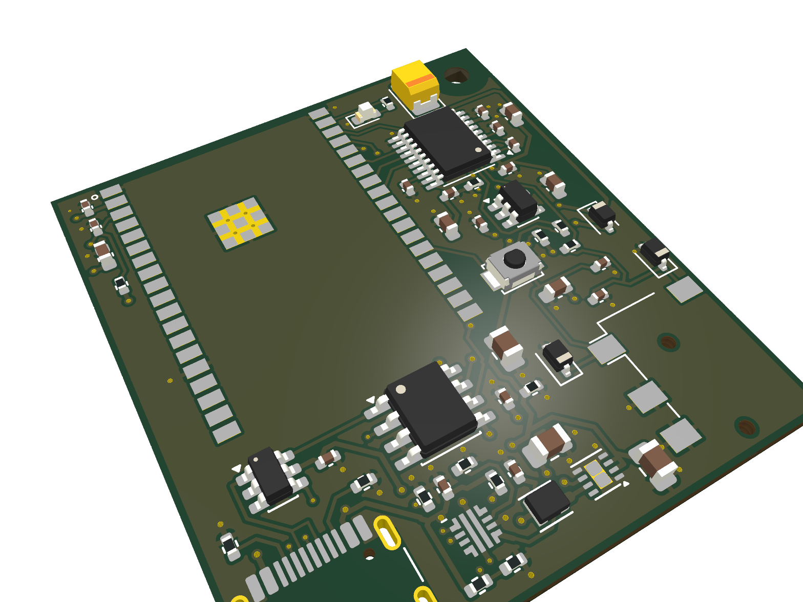

# LOVELACE / AS-006 rev A

ESP32-WROVER-E-N8R8 + PCM5102A 일체형 수신 보드. **37 × 41 mm, 4층**, 단면 실장(JLCPCB Economic PCBA 가능). USB-C 전원과 3.5mm AUX가 아래 변에 있고, 모듈 안테나는 위 변 밖으로 나갑니다. 전원 스위치 없이 USB를 꽂으면 켜집니다.



렌더 전체(PCBA, 맨 기판, 부품 배치도, 층별 배선, 이전 빌드와의 차이, 버전 기록)는 `renders/latest/index.html`에 있습니다. 이전 버전은 [archive](../archive/README.md)에 있습니다. AS-002 rev C는 크기·부품 배치가 AS-003과 같고, AS-003에서 AUX 잭 배정, DAC 뮤트·홀드업, JLC 회전, 배선을 고쳤습니다. AS-004는 AS-003과 넷리스트·배치가 같습니다. 상단 SMD 패드에 닿던 via 10개를 없애도록 배선만 고쳤습니다([REVIEW_LAYOUT.md](REVIEW_LAYOUT.md)). AS-005는 AS-004와 넷리스트·배치·배선이 같고, AUX 잭(J2) 랜드만 Shou Han PJ-320D 도면대로 고쳤습니다(위치 결정 NPTH Ø1.0mm, 패드 폭 1.5mm; [archive/06](../archive/06-lovelace-as-004-revA/README.md)). AS-006은 J2 패드를 잭 축에서 도면 위치(3.85mm)로 옮기고, J2를 0.3mm 왼쪽으로 옮겨 다시 배선했습니다([archive/07](../archive/07-lovelace-as-005-revA/README.md)). 펌웨어도 그대로 호환됩니다.

| | AS-001 (S3) | AS-002 rev B | **AS-006 rev A (현재, AS-003과 회로 동일)** |
|---|---|---|---|
| 크기 | 55 × 55 mm (3,025 mm²) | 35 × 50 mm (1,750 mm²) | **37 × 41 mm (1,517 mm², −50%)** |
| 전원 | USB-C + 슬라이드 스위치 | USB-C + PCM12 스위치 | **USB-C, 꽂으면 켜짐** |
| 버튼 | BOOT + RESET (TL3342) | BOOT + RESET (B3U) | **버튼 1개 (B3U, GPIO0)** |
| AUX 잭 | CUI SJ1-3523N (THT) | 동일 | **PJ-320D (SMD, C431535, 제조사 도면 랜드)** |
| 버크 인덕터 / 출력 C | 4 × 4 mm / 47µF 1206 | 동일 | **2.0 × 1.6 mm / 22µF 0805** |
| 고정 홀 | M3 × 4 | M2 × 2 | **M2 × 1 (오른쪽 위, NPTH, 나일론 나사 권장)** |
| 배선 | — | 미완료 | **완료 (KiCadRoutingTools 3단계 + 손 배선 3개), DRC 0, 패드 안 via 0** |
| 테스트 패드 | — | — | **바닥면 11개 (전원 레일, UART, EN, IO0)** |

## 회로

```
USB-C VBUS ─ TPS25947 eFuse (UVLO 4.26V / OVLO 5.80V / ILIM ≈0.65A) ─ +5V
   ├ CC1/CC2 5.1k                 +5V ─ TPS62162 buck (2.2µH 2016) ─ +3V3_D (L3 평면, ESP32)
   └ D+/D− ─ USBLC6 ─ CH340N ─ UART0   +5V ─ RB551V ─ +5V_DAC (220µF 홀드업) ─ TPS7A2033 ─ +3V3_A
ESP32-WROVER-E  GPIO21 BCK / GPIO19 DIN / GPIO18 LRCK ─ PCM5102A (AVDD·CPVDD·DVDD = +3V3_A)
                GPIO22 ─ XSMT (10k 풀다운 = 기본 뮤트)    ─ 470Ω/2.2nF ─ ESD ─ PJ-320D
                GPIO23 LED, GPIO0 버튼(+10k 풀업), EN = 10k/1µF RC
```

| 신호 | ESP32 | 모듈 핀 |
|---|---|---|
| I2S BCK | GPIO21 | 33 |
| I2S DIN | GPIO19 | 31 |
| DAC 뮤트 (XSMT, low = 뮤트) | GPIO22 | 36 |
| I2S LRCK | GPIO18 | 30 |
| Status LED | GPIO23 | 37 |
| 버튼 / 다운로드 모드 | GPIO0 | 25 |
| UART0 RX / TX | RXD0 / TXD0 | 34 / 35 |

I2S 핀은 DAC의 핀 순서(BCK, DIN, LRCK)와 같은 순서로 모듈에서 나오도록 다시 배정해 교차가 없습니다. 펌웨어(`config/sdkconfig.defaults.lovelace-wrover`)가 같은 핀을 씁니다. 5mm 정도로 짧아 직렬 33Ω 저항은 없앴습니다(1ns 에지 기준 임계 길이 약 25mm).

**버튼:** 짧게 = 재생/일시정지, 두 번 = 다음 곡, 3초 = Bluetooth 페어링(연결된 폰을 끊고 새 폰을 받음). 버튼을 누른 채 USB를 꽂으면 ROM 다운로드 모드로 들어갑니다(CH340N에는 DTR이 없음).

**팝 대책.** XSMT는 10k 풀다운이라 리셋·부팅 동안 DAC가 뮤트돼 있습니다. 펌웨어는 I2S 클럭이 20ms 돈 뒤 GPIO22로 뮤트를 풀고, 샘플레이트 변경·flush·`esp_restart` 전에는 다시 뮤트한 뒤 소프트 뮤트 램프(5ms)를 기다립니다. USB를 갑자기 뽑으면 D5가 막아 220µF가 DAC 쪽만 계산상 9.6ms(4.4V 입력에서 5.3ms) 버팁니다. 그동안 ESP32가 먼저 꺼지면서 I2S 클럭이 멈추고, DAC는 데이터시트 11.2절의 클럭 정지 소프트 뮤트(150 샘플 + 0.2ms = 3.6ms)를 마칩니다. 실측 전입니다.

PJ-320D는 4극(TRRS) 잭입니다. 풋프린트(`LOVELACE:Jack_3.5mm_PJ320D_Horizontal_ShouHan`)는 Shou Han 도면을 따릅니다. 위치 결정 홀 Ø1.0mm(핀 Ø0.75mm), 플러그 축 방향 패드 폭 1.5mm, 축 방향 패드 위치는 KiCad `Connector_Audio:Jack_3.5mm_PJ320D_Horizontal`과 같습니다(도면과 0.1mm 이내). 축에서 패드까지는 도면대로 몸체(폭 6.1mm) 바깥 3.05–4.65mm에 랜드를 두되, 양 끝을 0.2mm씩 늘려 2.85–4.85mm(길이 2.0mm)로 했습니다. KiCad 풋프린트는 2.0–4.5mm라 1mm가 몸체 아래로 들어가고 단자 끝을 덮지 못했습니다. `cpl.csv`의 J2 좌표는 패드 평균이 아니라 위치 결정 핀 기준입니다(JLC 핀과 우리 홀 차이 0.000mm). 패드 이름(T/R1/R2/S)은 실제 접점과 맞지 않습니다. HRO·Shou Han 도면 기준으로, 개구부에서 가장 먼 단독 패드(KiCad `S`)가 Tip = LINE_L이고 `T` 패드가 Ring = LINE_R입니다. 개구부 쪽 두 패드(`R1`, `R2`)는 일반 3극 플러그의 슬리브가 함께 닿으므로 둘 다 GND입니다. `audit_pcb.py`는 이름 대신 개구부에서의 거리 순서로 이 배정을 검사합니다.

고정 홀 H1(M2, 2.2mm NPTH)은 오른쪽 위에 있고, 지름 5.5mm 안에는 구리가 없습니다. 안테나 끝에서 약 11mm 떨어져 있으므로 금속 대신 나일론 나사·스페이서를 권장합니다.

## 층 구성

L1 부품 + 신호 + GND pour, **L2 GND 전면**, L3 +3V3_D 전면, L4 신호 + GND pour. +3V3_A(약 30mA)는 LDO에서 DAC로 배선합니다.

## 생성

### 실크 인쇄 편집기

repo 루트에서 `python3 tools/silkscreen_editor.py`를 실행하고 출력된 전체 로컬 URL을 엽니다.
KiCad 10의 Python과 CLI를 자동으로 사용하며, 별도 패키지 설치는 필요 없습니다.
KiCad를 다른 위치에 설치했다면 `KICAD`를 해당 앱의 `Contents` 경로로 지정합니다.

- 앞·뒷면에서 SVG와 텍스트를 배치하고, 드래그 또는 mm 좌표·크기·회전 입력으로 조정합니다.
- 좌표는 선택한 면의 왼쪽 위 기준입니다. 뒷면을 밖에서 읽는 방향으로 편집하며, PCB 좌표와 미러 처리는 자동입니다.
- SVG의 불투명 영역은 단색 실크로 변환합니다. 흰 배경이 있으면 `흰 배경 제외`를 선택합니다. SVG 내 외부 이미지·실행 코드·애니메이션은 지원하지 않습니다.
- SVG는 0.025 mm 간격으로 샘플링한 뒤 채워진 KiCad 도형으로 저장합니다. 복잡한 곡선은 근사되며 원본 SVG도 편집 파일에 보관됩니다. 텍스트 미리보기 글꼴은 실제 KiCad 글꼴과 다릅니다.
- 구리 배선·패드 표시를 켜면 현재 면의 배선과 보드 경계선을 함께 봅니다(구리 평면은 생략). 마스크로 덮인 배선 위 실크는 허용됩니다.
- `실제 인쇄·간섭 검사`는 저장 전 배치를 임시 PCB에 적용해 KiCad 실제 글꼴로 렌더하고, 현재 면의 실크 간섭을 빨간 상자·번호로 표시합니다. 원본 PCB는 바꾸지 않습니다. `편집 계속`으로 돌아가 수정한 뒤 다시 검사하세요. 전체 제작 검사는 `make_board.sh`로 수행합니다.
- `PCB에 저장`은 현재 보드 파일(`lovelace-as-006.kicad_pcb`)과 `silkscreen.json`을 업데이트합니다. 편집기는 `hardware/versions.json`에서 현재 보드를 찾고, 화면에 보드 ID와 rev를 표시합니다. 기존 board-level 실크를 편집기가 관리하며, footprint의 실크·구리 배선·부품 배치는 유지합니다.
- 저장 전 PCB는 `.silk-backup.kicad_pcb`, 이전 배치는 `silkscreen.json.bak`으로 1회분 백업합니다. 다른 프로그램이 파일을 수정했으면 저장을 거부합니다. 저장할 때 KiCad 프로젝트를 닫으세요.
- `make_board.sh`로 재생성해도 `silkscreen.json`이 적용됩니다. 편집기 저장만으로 Gerber·release ZIP이 갱신되지는 않습니다. 제작 전 아래 생성 명령과 DRC로 패드·가장자리 간섭을 확인하세요.

검증: `node tests/test_silkscreen_mask.js`; KiCad Python으로 `-m unittest discover -s tests -p test_silkscreen.py -v`.

```sh
./make_board.sh               # 재생성 + JLC 대조 + 배선 + 검사 + release zip + 렌더
RENDER=0 ./make_board.sh      # 렌더 생략
./make_board.sh anneal 3      # 수동 부품 배치를 다시 탐색(seed 3)
ROUTER=freerouting REROUTE=1 ./make_board.sh   # 비교용: FreeRouting으로 배선
```

| 스크립트 | 역할 |
|---|---|
| `plan_pcb.py` | 넷리스트, 큰 부품과 DAC 주변의 수동 배치, 검사 규칙, LCSC 부품 번호 |
| `autoplace.py` | 나머지 수동 부품을 스킬 검사기 규칙(간격, 가장자리, keep-out, near/apart)과 핀 단위 배선 길이를 비용으로 annealing |
| `build_pcb.py` | 보드·회로도·BOM·CPL·DSN 생성, 직접 그린 배선(버크 SW, USB D+/D−, VBUS, 평면 via), 고정 UUID |
| `jlc_check.py` | JLC/EasyEDA 부품 데이터와 패드·극성 대조, JLC 기준 회전·원점으로 `cpl.csv` 작성, 재고와 Basic/Extended 보고(`reports/jlc.json`) |
| `finish_pcb.py` | (FreeRouting이면 .ses 가져오기) KiCad 연결성 기준으로 쓰지 않은 via 정리, 바닥 테스트 패드, 평면 채우기 |
| `render_board.py` | 3D PCBA·맨 기판, 부품 배치도, 층별 구리, 넷 종류별 배선도, 이전 빌드와의 차이, `index.html` |
| `pinout_check.py` | 데이터시트에서 따로 적은 핀 표와 넷리스트 대조(138개 항목, [REVIEW_NETLIST.md](REVIEW_NETLIST.md)) |
| `sim/power_path.py` | ngspice 전원 경로 동작 모델: eFuse 기동, ESP32 펄스 부하 때 5V 처짐, USB 분리 때 C25 홀드업([REVIEW_NETLIST.md](REVIEW_NETLIST.md) 4절) |
| `render_extra.sh` | `renders/extra/`: 3D 뷰(6면 + 6각도), 층별 SVG, 전체 층 PDF, 보드 SVG, 회로도 PDF (`QUALITY=basic`이면 빠름). U1·J1·J2는 3D 모델이 없어 빠집니다 |
| `audit_pcb.py` | 좌표·핀넷 readback, 디커플링 패드 거리, 라이브러리와 패드 형상 비교, AUX 잭 접점 순서 |

필요한 것: KiCad 10(`/Volumes/KiCad` 마운트)과 `work/tools/` 아래 세 가지입니다. [pcb-layout-skill](https://github.com/studio-edul/pcb-layout-skill) 체크아웃(`pcb-layout-skill/`, 다른 위치면 `SKILL`로 지정), [KiCadRoutingTools](https://github.com/drandyhaas/KiCadRoutingTools) v0.23.0(`krt/`), 그리고 numpy·scipy·shapely를 설치한 venv(`krt-venv/`)입니다. 설치 후 `krt-venv/bin/python krt/build_router.py`로 라우터 바이너리를 받습니다. FreeRouting 비교에는 FreeRouting 2.5.0과 Java 25 런타임이 더 필요합니다.

배선은 KiCadRoutingTools를 씁니다. 같은 배치에서 FreeRouting과 비교한 결과입니다(둘 다 DRC 0).

| | FreeRouting | KiCadRoutingTools (현재) |
|---|---:|---:|
| 신호 배선 길이 / 세그먼트 | 442mm / 371 | 403mm / 239 |
| 0.2mm 미만 세그먼트 | 53 | 9 |
| 전원 0.225mm 넥다운 | VBUS·+5V·+5V_DAC·+3V3_A 14mm | 없음 (0.25mm 손 배선 2mm만) |
| 오디오 넷의 B.Cu(디지털 전원 평면 위) 구간 | DAC_L/R, LINE_L via 6개 | 없음 |
| 아날로그–잡음선 최소 간격(같은 층) | 0.37mm | 1.14mm |
| 신호 via | 35 | 32 |
| 재현성 | 실행마다 다름 | 항상 같음 |

KiCadRoutingTools는 3단계로 배선합니다. ① 오디오 넷(DAC_L/R, LINE_L/R, VNEG, CAPP/CAPM, LDOO)을 F.Cu에만, ② 전원(VBUS, +5V, +5V_DAC, +3V3_A, SW)을 0.3mm 고정으로(축소 금지), ③ 나머지를 0.2mm로(자리가 없으면 보드 최소값 0.15mm까지) 배선합니다. +5V_DAC의 C25 → D5 구간은 `build_pcb.py`가 오른쪽 가장자리로 직접 그립니다. 라우터에 맡기면 I2S 세 선을 가로질러 I2S가 바닥층으로 넘어갔기 때문입니다. eFuse의 OVLO·ILIM(2 × 2mm QFN 가운데 핀)도 `build_pcb.py`가 그립니다. via를 패드에서 띄우면 라우터가 빠져나갈 길을 찾지 못하기 때문입니다. via를 놓는 ②③단계는 `--same-net-pad-clearance 0.1`로 via를 같은 넷 SMD 패드에서 0.1mm 이상 띄웁니다. 메우지 않은 via가 패드 안에 있으면 리플로 때 땜납이 빠져나가기 때문입니다. ①이 끝나면 오디오 배선을 잠가서, ②③이 막혔을 때 이를 뜯어 B.Cu로 옮기지 못하게 합니다. `audit_pcb.py`는 상단 SMD 패드에 닿는 via가 있으면 실패합니다. 보드 항목 UUID를 고정해 같은 설계는 항상 같은 배선이 나옵니다.

## 상태 (2026-10-16, AS-006)

- 배치 검사 ERROR 0 / WARN 0, 점유율 76%.
- KiCad DRC 0, 미연결 0, 회로도 parity 0, ERC 0(위반이 있으면 `make_board.sh`가 릴리스 전에 멈춤). 디커플링 패드 거리 19/19, 라이브러리 패드 일치 54/54, JLC 부품 데이터 대조 53/53.
- 릴리스 감사 0/0(BOM·CPL 포함), Gerber netcheck shorts 0 / opens 0. `lovelace-as-006-revA-release.zip`에 Gerber, drill, IPC-D-356, JLC 형식 BOM / CPL.
- AS-005 대비: J2 패드 위치·길이, J2 위치(x 32.0 → 31.7mm), 그에 따른 재배선(세그먼트 328, via 96, 길이 498 → 496mm, 오디오 넷 B.Cu 0), J2 CPL. 넷리스트와 다른 부품 위치는 같습니다.
- 제작 전 확인할 항목은 [REVIEW.md](REVIEW.md), 주문과 첫 보드 확인 절차는 [BRINGUP.md](BRINGUP.md)에 있습니다.
